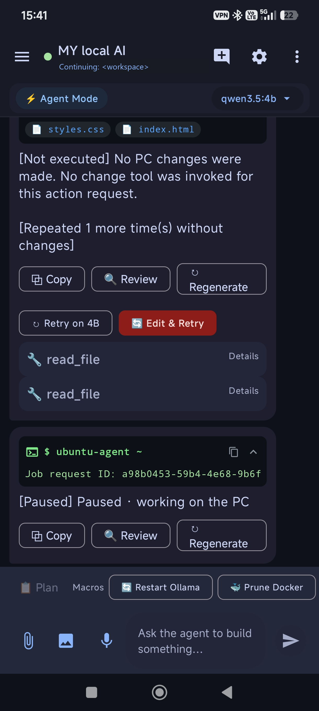
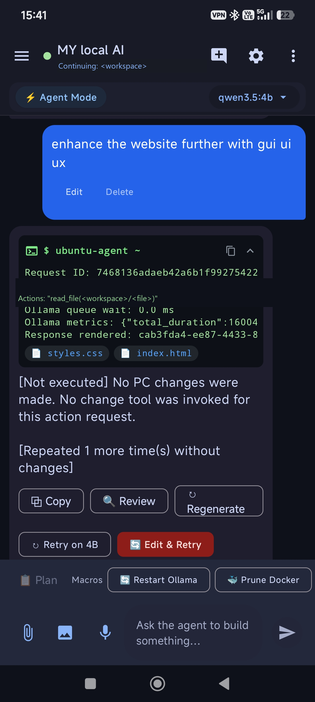
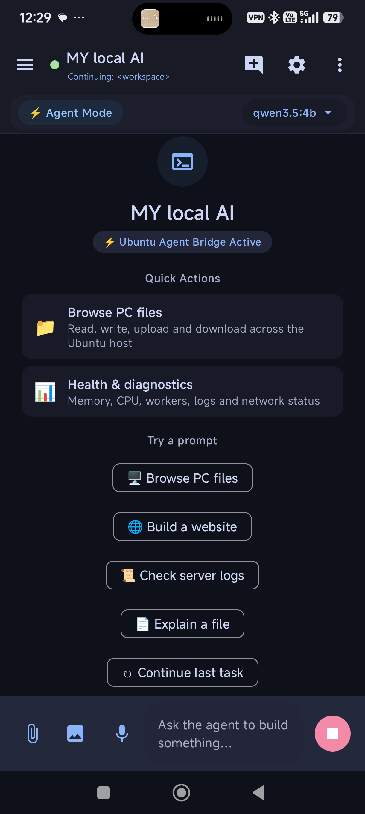
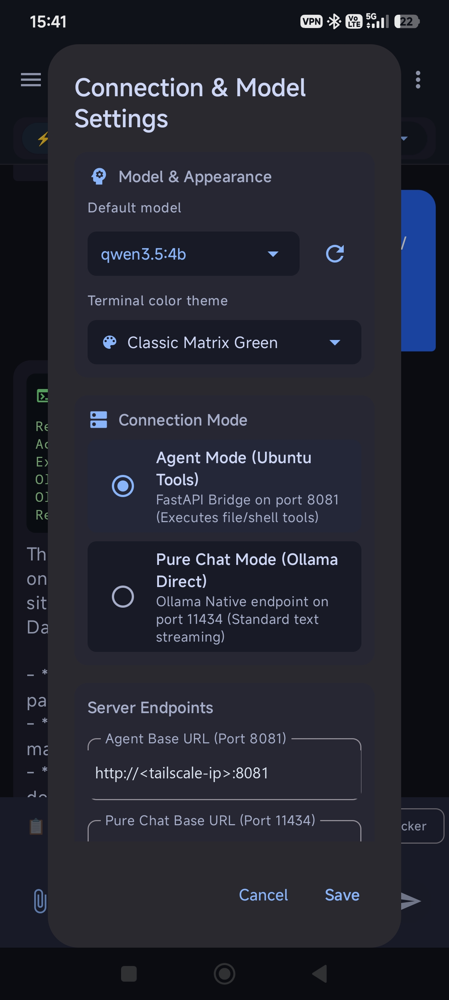
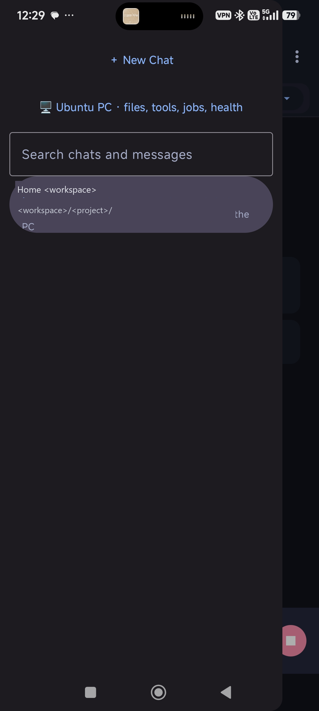
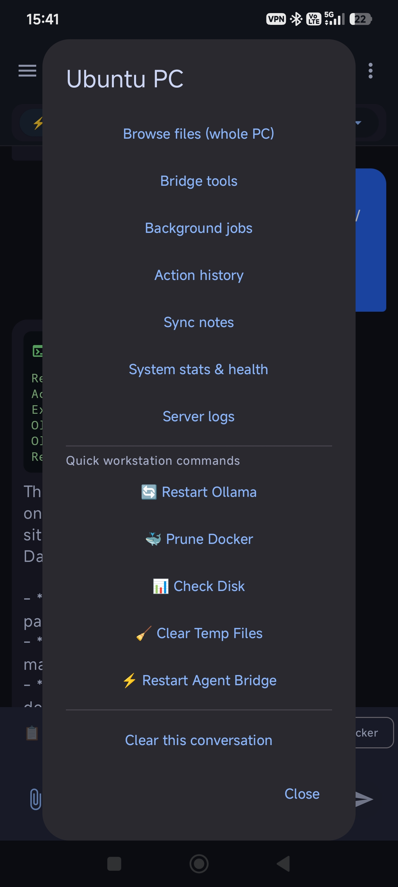

# MY local AI — Android Agent Client


A Jetpack Compose Android app that talks to an **Agent Bridge** over Tailscale. The
conversation is the task surface: you type a request, the agent works on the Ubuntu PC,
and tool activity appears inline — no separate "create task" form in the main flow.

```text
Android Client (Jetpack Compose) ──(Tailscale)──▶ Agent Bridge (:8081) ──▶ Ollama (:11434)
        │                                          │
        ├─▶ Room DB (schema v3) & DataStore         ├─▶ SQLite (jobs, sessions, memory)
        └─▶ WorkManager (completion & notifications)
```

## Features

### Execution & streaming
- Async chat jobs (`POST /api/chat/jobs`) with a stable `Idempotency-Key`; no duplicate jobs on retry.
- Live SSE progress with reconnect and event backfill; `token` events stream into the answer.
- Inline tool activity (`tool_started` / `tool_result`), 15 s heartbeats, one "Working… · Xs" header.
- Direct mode by default (inline file/command/research work); durable task delegation is opt-in.

### Session continuity
- Server-backed session memory: goal, workspace, touched files, decisions, last successful turn.
- Referential follow-ups ("enhance it", "the website") continue the same task in the same workspace.
- Per-chat task shown in the header and drawer; **Continue last task** button.
- Prompt queue: send several prompts while one runs; `⏳ N` in the top bar, reorder/cancel panel; queue persists.

### Control & safety
- Plan preview before work; small-model review sub-agent; Undo for file writes.
- Per-tool allow-list, notification preferences, command approval dialog.
- Optional `X-Bridge-Token` auth configured from `.env`.
- Clean final answers: no raw tool dumps, no fake success claims.

### Files, diffs & downloads
- Whole-PC file browser with root toggle, read/write/copy/move/delete/upload/download.
- Download notifications + in-chat status banner.
- Clickable file chips (preview, copy path, browser), inline unified diff cards.
- Python/JS/HTML verification results inline.
- Chat export via share sheet; message deletion.

### Resilience
- Offline hold/reconnect with the same key; jobs restore on app start, reconnect and tab switch.
- Cancelling the phone's tracker no longer kills the PC job.

## Architecture

| Layer | Files |
| :--- | :--- |
| **UI** | `MainActivity.kt`, `ui/ChatViewModel.kt`, `ui/components/*` |
| **Data** | `data/ChatRepository.kt`, `data/remote/ApiService.kt`, `data/local/*`, `data/PreferencesRepository.kt` |
| **Models** | `model/ApiModels.kt`, `ChatMessage.kt`, `SessionStateDto.kt`, `QueuedPromptData.kt`, `AgentExtras.kt` |
| **Background** | `worker/*`, `notification/*` |
| **CLI** | `cli/agent_cli.py` — original MIT terminal client |
| **Connectivity** | `network/NetworkMonitor.kt`, `MyLocalAIApplication.kt` |

## Build & test

```powershell
Get-Process java,javaw -ErrorAction SilentlyContinue | Stop-Process -Force
.\gradlew.bat :app:compileDebugKotlin :app:testDebugUnitTest :app:assembleDebug --no-daemon --max-workers=1
```

- Debug APK: `app/build/outputs/apk/debug/app-debug.apk`
- Unit tests: **38 tests**, 0 failures. CI runs them on push/PR.

## Configuration

Copy `.env.example` to `.env` and set `REMOTE_API_BASE_URL` (your Tailscale bridge URL),
optionally `BRIDGE_TOKEN`. The Android app reads only these two values; `CLI_MODEL` belongs
to `cli/agent_cli.py` and cloud keys belong on the bridge host (see the bridge `RELEASE.md`).
`.env` is gitignored; nothing sensitive is committed.

```bash
curl -s http://<tailscale-ip>:8081/api/health
curl -s http://<tailscale-ip>:8081/api/version
```

## Publishing

See `PUBLIC_RELEASE.md` for the published `v1.0.0` signed APK and bridge installer,
`SECURITY_AUDIT.md` for the verified final state, `SECURITY.md`, `LICENSE` and `CHANGELOG.md`.

## Languages / RTL
- Settings → Language: System default, English, **עברית**, **العربية**.
- Full Hebrew and Arabic translations of all UI strings; RTL layout is enabled.
- The selected language is sent to the bridge so final answers are localized.
- For fluent **local** Hebrew/Arabic, install `ollama pull gemma3:4b` on the bridge host;
  the bridge routes `he`/`ar` chat to it automatically and falls back to the usual local
  models when it is not installed. No cloud key is required.

## Verified status (2026-11-27)
- Android: 38/38 unit tests pass, release APK builds, CI green.
- Bridge: 90/90 unit tests and `smoke_test.py` 11/11 checks in a fresh public clone.
- Both public repos on `main` at `v1.0.0`; no secrets in tracked files.

## Screenshots

<p align="center">
  
  
  
</p>
<p align="center">
  
  
  
</p>

Internal Tailscale addresses and home-directory paths in the original screenshots were
replaced with placeholders before publishing.

## Troubleshooting

- **JVM OOM:** stop stale `java` processes and use `--no-daemon --max-workers=1`; retry once.
- **No task memory:** ensure the bridge exposes `GET /api/session-state` and the APK is current.
- **On-device logs:** `adb logcat -s MyLocalAI:D` — IDs/statuses only, never prompt content.
